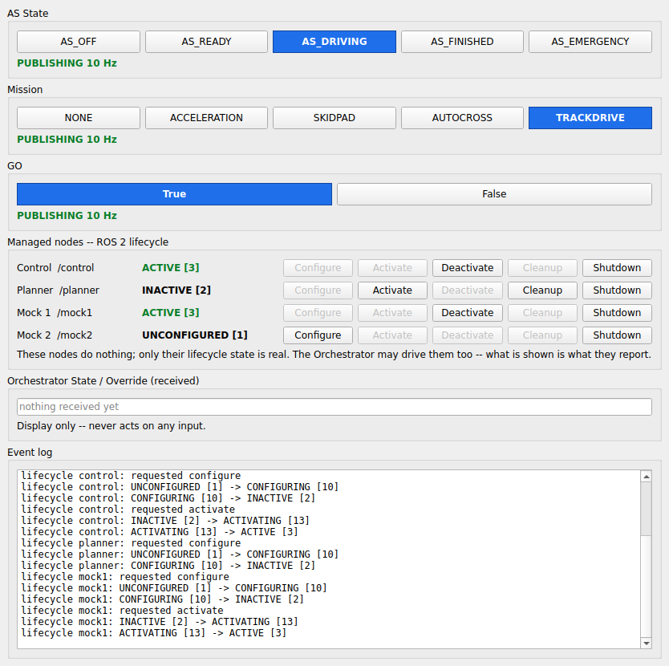

# Mock Bridge

A manual stand-in for `fs_uart_bridge`, for testing the **real Orchestrator**
without the VCU, STM32, UART or vehicle. It publishes the same three topics
the real bridge publishes, at 10 Hz, with the values you click — and nothing
else. It never emulates a VCU, never validates a combination, and never reacts
to anything the Orchestrator says.

Invalid combinations are the point: you can publish `AS_DRIVING` with no
mission and `GO=False`, because that is a thing the Orchestrator has to cope
with and no amount of real hardware will let you produce it on demand.

It also starts four **managed lifecycle nodes** — `control`, `planner`,
`mock1` and `mock2` — that do nothing at all beyond following their ROS 2
lifecycle, so the Orchestrator's lifecycle management has something to drive,
and you can drive it by hand from the same window.



## The ROS interface

Every name, type and QoS below was read off the real sources, not proposed.
`mock_bridge/ros_interface.py` names the file each one came from.

| Direction | Topic | Type | QoS |
| --- | --- | --- | --- |
| publish | `/detached_sensor/as_state` | `std_msgs/UInt8` | reliable, transient-local, depth 1 |
| publish | `/detached_sensor/mission` | `std_msgs/UInt8` | reliable, transient-local, depth 1 |
| publish | `/detached_sensor/go` | `std_msgs/Bool` | reliable, transient-local, depth 1 |
| subscribe (display only) | `/vehicle/as_override` | `fs_msgs/ASOverride` | reliable, volatile, depth 10 |

AS state values are the STM32's numbering, cross-checked against
`fs_msgs/ASOverride`'s constants at startup — a renumbering on either side is
a loud failure, not a wrong value on the wire:

    AS_OFF 0   AS_READY 1   AS_DRIVING 2   AS_FINISHED 3   AS_EMERGENCY 4

**Mission ids are provisional.** The real protocol carries the mission as a
raw id whose mapping is "TBD by firmware"
(`fs_uart_protocol_v2.ASStateFrame`), so `NONE 0 … TRACKDRIVE 4` in
`mock_bridge/channels.py` are placeholders. Nothing depends on the particular
numbers; fix them there when the firmware says.

All four topic names are launch arguments, because `SENSOR_NS` is marked
temporary in the real bridge and the Orchestrator's own plan proposes
different names (`/bridge/as_state` and friends) while explicitly deferring to
whatever the bridge actually does:

```bash
ros2 launch mock_bridge mock_bridge.launch.py as_state_topic:=/bridge/as_state go_topic:=/bridge/go
```

## The managed lifecycle nodes

`control`, `planner`, `mock1` and `mock2` are real ROS 2 lifecycle nodes with
no behaviour: every transition callback logs and returns SUCCESS. No timers,
no publishers, no subscriptions, no work. They are one class under four names;
`control` and `planner` are the two the Orchestrator's state machine activates
by name, and `mock1` / `mock2` are spares to point at whatever it is made to
manage next. What they reproduce faithfully is the *interface* —
`/<node>/get_state`, `/<node>/change_state` and `/<node>/transition_event`,
with the standard state machine behind them, enforced by rcl rather than by
us. That is exactly what the Orchestrator's `LifecycleManager` calls.

The GUI shows each node's state and offers only the transitions that are legal
from it (`unconfigured` → configure, shutdown; `inactive` → activate, cleanup,
shutdown; `active` → deactivate, shutdown; `finalized` → nothing). State comes
from the nodes themselves, two ways: a `transition_event` subscription, which
catches a change made by anyone — this GUI, the Orchestrator, `ros2 lifecycle
set` — and a `get_state` poll once a second, which is what gives the right
answer for a node that was already running, and what notices one that has gone
away (shown as `unknown`, never as a plausible-looking state).

All four node names are launch arguments. The Orchestrator's `config.yml`
expects names of its own — `control_node`, `skidpad_planner_node`,
`acceleration_planner_node`, `lidar_reader_node`, `camera_reader_node` — and
records that none of them exist in the workspace yet, which is the gap these
fill. Five expected names, four nodes here: point them wherever a test needs
them.

```bash
ros2 launch mock_bridge mock_bridge.launch.py control_node_name:=control_node planner_node_name:=skidpad_planner_node mock1_node_name:=lidar_reader_node mock2_node_name:=camera_reader_node
```

One rclpy bug is worth knowing about, because this package works around it on
both sides. In Jazzy, a `change_state` request for a transition that is not
registered in the current state raises inside rclpy's own service handler, and
the exception comes out of `spin()` and kills the node process (the
Orchestrator's README documents the same thing). So the client never sends a
transition the state does not allow, *and* the managed nodes keep spinning
through it — a stale request costs the sender a timeout, not the node.

## Never run it beside the real bridge

Both would publish the same topics and the Orchestrator would see interleaved
values. Stop the vehicle stack first, or start it with `ENABLE_BRIDGE=false`.
A few seconds after startup the node checks its own topics and logs a warning
naming any other publisher it finds — it cannot stop you, only tell you.

## Build and run

Needs Docker, and `fs_msgs` from the pedal_node workspace, which the build
pulls in as a second build context (`../pedal_node/src/fs_msgs`).

```bash
./scripts/run_gui.sh --build
```

That grants the container access to your X display, brings it up, and takes
the access away again when it exits. Without a display:

```bash
./scripts/run_console.sh
```

The console is the same node driven from the keyboard — useful over ssh and
for scripted checks:

```
as_state AS_READY     select, or switch to, a value   (a / m / g also work)
as_state              deselect: that channel stops publishing entirely
lc                    the managed nodes' lifecycle states
lc control activate   ask a managed node for a transition
status                what is publishing, the last feedback, the lifecycle
help | quit
```

Plain Docker, without compose:

```bash
docker build -t bgr_mock_bridge --build-context fs_msgs=../pedal_node/src/fs_msgs .
```

## Using the GUI

- Click a value to publish it at 10 Hz. Click it again to **stop that channel
  entirely** — no OFF, no NONE, no False, no final message. Click a different
  value to switch immediately; the old value is never published again.
- The three channels are independent. Stopping one leaves the others running.
- Nothing is published until the first click.
- The read-only field shows the last Orchestrator State / Override received.
  It is display only. In this project those two names are the same
  information, not two subscriptions.
- The event log records selections, starts and stops, *changed* feedback
  values, and every lifecycle transition — not every message, or it would
  scroll at 10 Hz.
- A lifecycle button is a request, not a selection: the row moves when the
  node reports its new state, so it can never show a state the node is not
  actually in. You will see the intermediate `CONFIGURING` / `ACTIVATING`
  states go by, because the node publishes those too.
- Closing the window stops the publishers before it goes. It deliberately
  leaves the managed nodes in whatever state they are in — they are separate
  processes, and closing a window is not a reason to deactivate the stack
  underneath it.

One DDS detail worth knowing when reading a test: transient-local means the
last sample stays retained, so an Orchestrator that starts *after* you
deselect still receives that one value once. Deselecting stops this node
publishing; it cannot un-send what DDS kept. The real bridge behaves the same
way, which is why the QoS matches it rather than going volatile.

## Tests

```bash
./scripts/run_tests.sh
```

82 tests, inside the image, on their own `ROS_DOMAIN_ID` with Qt offscreen —
safe to run while something else is on the graph. By layer:

| File | Needs | Covers |
| --- | --- | --- |
| `tests/test_state.py` | nothing | the toggle rules, as a pure state model |
| `tests/test_lifecycle.py` | nothing | which transitions each lifecycle state offers, and how it reads |
| `tests/test_node.py` | rclpy, fs_msgs | publication on a real DDS graph, rate, feedback, the rival-publisher warning |
| `tests/test_lifecycle_nodes.py` | rclpy, fs_msgs | driving the managed nodes over their services, following a transition made by someone else, surviving the rclpy bug |
| `tests/test_gui.py` | PySide6 | real Qt clicks against a stub controller, including the lifecycle rows |
| `tests/test_gui_ros.py` | both | a button click coming out as a ROS message |

On a host with the workspace sourced they run directly too, and each file
skips cleanly when what it needs is missing:

```bash
source /opt/ros/jazzy/setup.bash && source ../pedal_node/install/setup.bash && python3 -m pytest tests -q
```

## Layout

    mock_bridge/channels.py      what values exist, and what each sends
    mock_bridge/state.py         the toggle rules; no ROS, no Qt
    mock_bridge/ros_interface.py topics, types, QoS, and where each came from
    mock_bridge/node.py          publishers, the 100 ms timer, the subscriber
    mock_bridge/lifecycle.py     lifecycle states and transitions; no ROS, no Qt
    mock_bridge/lifecycle_nodes.py  the four managed nodes that do nothing
    mock_bridge/lifecycle_client.py watches and drives them
    mock_bridge/runner.py        spins ROS on its own thread
    mock_bridge/gui.py           the PySide6 window
    mock_bridge/headless.py      the keyboard console
    launch/mock_bridge.launch.py topic and node-name arguments, three processes

The state model is the single source of truth: the GUI holds no selection of
its own, it hands clicks to the node and redraws from the model, so what is
highlighted is always what is being published.

## Status

Steps 1–4 of `PLAN (3).md` are implemented and tested. The four managed
lifecycle nodes are an addition on top of it, not part of that plan; they were
driven end to end from the launch file — the GUI reports all four as
`unconfigured` within a second of startup, and follows each through configure,
activate, deactivate, cleanup and shutdown whether the request comes from the
GUI or from `ros2 lifecycle set`. Step 5's other half —
validating against the real Orchestrator — is **not done**: the Orchestrator
package was reset to a bare skeleton on 2026-11-20 (`67d8855`, `1fd885a`) and
currently has no subscriptions, no publishers and no parameters, so there is
nothing yet to send these inputs to or to receive feedback from.

What that leaves confirmed, and what does not:

- The publisher contract matches what the Orchestrator subscribed to as last
  built — `/detached_sensor/as_state` and `/detached_sensor/mission`,
  `std_msgs/UInt8`, transient-local — observed on a live graph.
- `/detached_sensor/go` is a *dynamic* subscription in that design, created
  only while the VCU reports AS_READY, so its absence from the Orchestrator's
  subscriber list is expected until then.
- Untested end to end: the Orchestrator's reaction to a mission change while
  AS_READY or AS_DRIVING (plan scenario 5), and the feedback display with a
  real override publisher (scenario 7) — the mock's side of both is covered by
  `tests/test_node.py` against a stand-in publisher.

Re-check these once the Orchestrator has its ROS layer again, and re-read its
topic names at the same time: its plan proposes `/bridge/*`, and whichever way
that lands, it is a launch argument here, not a code change.
